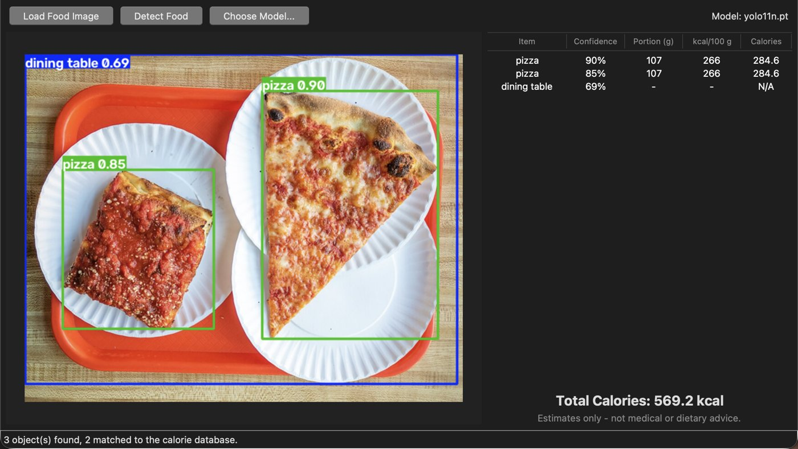

**[See the code on GitHub →](https://github.com/karanamtej1-lab/food-calorie-detection)**
On Windows, double-click `run_windows.bat`. It sets everything up and opens the app.

## Overview

Pick a photo of a meal and click **Detect Food**. The app draws a box around
each item it recognizes, looks it up in a nutrition table, and adds up an
estimated calorie total. Every row shows its work: confidence, assumed
portion, kcal per 100 g, and the result.

It's a prototype and it says so. The numbers are estimates, not dietary advice.

## How it works

1. **Load.** Pillow opens the image (JPG, PNG, BMP, or WEBP) and converts it to RGB.
2. **Detect.** Ultralytics YOLO11 runs on a background thread so the window
   doesn't freeze.
3. **Match.** Each class name is cleaned up (`Hot_Dog` becomes `hot dog`,
   `doughnut` becomes `donut`) and looked up in the calorie table.
4. **Estimate.** kcal per 100 g × assumed portion in grams ÷ 100. A pizza
   slice is 266 × 107 ÷ 100 = 284.6 kcal.
5. **Show.** Annotated image, a table of items, and the total. Anything not in
   the table shows `N/A` and doesn't count.

## What I learned

**The model knows less food than you'd think.** The default YOLO model is
trained on COCO, which has 80 classes. Only 10 are foods: apple, banana,
orange, broccoli, carrot, sandwich, hot dog, pizza, donut, and cake. I built
the calorie table around those 10. Rice, dosa, idli, dal, and the rest are in
the table too, but they need a food-trained model. Drop one in `models/best.pt`
and the app uses it automatically.

**It's confidently wrong sometimes.** On a fruit bowl it labeled papaya and
pineapple as "carrot." Pizza worked well. That's the main limitation of a
general-purpose model, and I document it instead of hiding it.

**Tkinter and threads don't mix.** Running detection on the main thread froze
the window. Updating the UI straight from the worker thread crashed in testing
with "main thread is not in main loop." The fix: the worker puts its results on
a queue, and the main thread checks it every 100 ms.

**Color order matters.** YOLO reads raw arrays as BGR, the OpenCV order. Pass
it an RGB array and red and blue silently swap. Handing it the Pillow image
directly avoids that.

**Tests for the math.** pytest checks the calorie logic, including the worked
example from my documentation (rice: 130 × 180 ÷ 100 = 234 kcal), and checks
that all 10 COCO food classes are covered.

## Status

Working, source on
**[GitHub](https://github.com/karanamtej1-lab/food-calorie-detection)** with full
project documentation in `docs/`. Next: train a food-specific model, let users
edit portion sizes, and add protein, carbs, and fat.

Photo in the screenshot: "L&B Spumoni Gardens pizza" by
[Rhododendrites](https://commons.wikimedia.org/wiki/User:Rhododendrites),
[CC BY-SA 4.0](https://creativecommons.org/licenses/by-sa/4.0).
