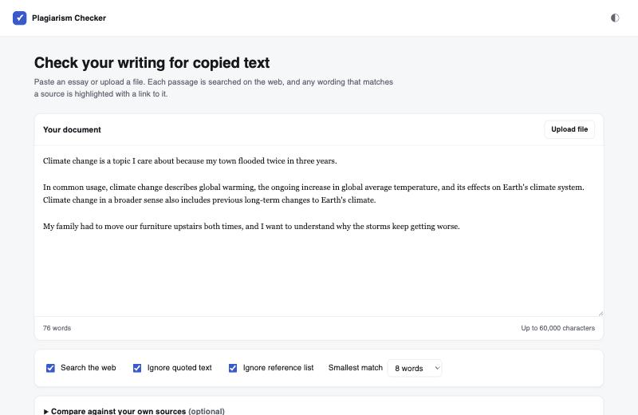
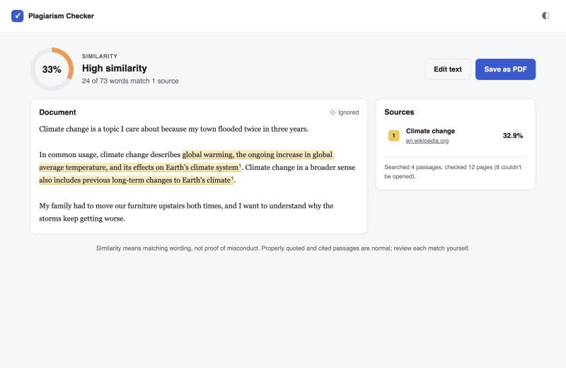
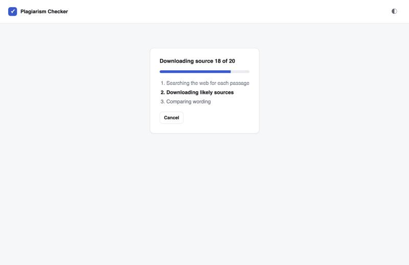

**[Try the finished app →](https://plagiarism-checker-nu-inky.vercel.app)**
Paste a few paragraphs and click *Check for plagiarism*. A check takes about
5 to 10 seconds. Source is on
[GitHub](https://github.com/karanamtej1-lab/plagiarism-checker).

## Overview

Turnitin costs money, and most students only see it after they've already
turned the paper in. I wanted a free checker that shows exactly which words
match which page, not just a percentage.

It started as a rewrite of an open-source project,
[Free-Turnitin-Plagiarism-Checker](https://github.com/cu-sanjay/Free-Turnitin-Plagiarism-Checker).
I kept the idea and rebuilt the matching, the search, and the interface from
scratch.

What you get:

- **A similarity score**: the share of your words that match a source.
- **Highlights**: every copied phrase is colored by the source it came from.
  Click one to see all the text from that source.
- **A source list** with a link and a percentage for each page.
- **File upload** for .txt, .docx and .pdf.
- **Quotes and references ignored** by default, since quoting and citing is
  allowed.
- **Your own sources**: paste in a classmate's draft or a paywalled article to
  check against text a search engine can't reach.
- **Save as PDF** for a printable report.

## How it works

### Finding sources

The essay is split into sentences. Up to 24 of them, spread across the whole
document, become search queries. Each one goes to DuckDuckGo and to
Wikipedia's search API. A page that comes back for several different
sentences is probably the source, so pages are ranked by how many queries
found them. The top 20 get downloaded in parallel and stripped down to plain
text.

The server streams its progress back one line at a time, so the progress bar
shows real work instead of a spinner.

### Matching: shingles, not word counts

The original project compared each sentence against the whole web page by
counting shared words (cosine similarity). That flags almost everything,
because every English page shares "the", "and", and "of" with your essay.

I used **shingles** instead: every run of 5 words in a row. A word counts as
copied only when it sits inside a 5-word run that also appears on the source
page. Shingles made only of filler words ("one of the most") are skipped.

That still flagged stock phrases like "at the end of the day." So a match
also has to run at least 8 words in a row before it counts. Turnitin has the
same kind of setting, and you can change it in the app.

### Giving each word one source

When two pages contain the same passage, both match the same words. If I
added up each source's matches, the total could go over 100%. So the source
that covers the most words claims them first, and every later source only
gets words nobody has claimed yet. The per-source percentages always add up
to the overall score.

## What broke, and what I learned

**The search engines started blocking me.** After a few test runs in a row,
DuckDuckGo stopped returning results and sent a bot check instead. Wikipedia
returned "You are making too many requests," even though I wasn't. Wikipedia
actually wanted a contact link in the request's User-Agent header; adding one
fixed it. For DuckDuckGo, I added Bing as a backup. When DuckDuckGo blocks,
the app switches to Bing for five minutes, then tries DuckDuckGo again.

**Deploying took four tries.** The first deploy came up as a static site with
no server, because Vercel only treats a file as an Express app if that file
imports Express itself. Then Vercel blocked a deploy because the commit
author's email wasn't linked to my account. Then PDF uploads worked on my
laptop but failed online with "bad XRef entry." I ran the same file on Node
20, 22 and 24 and found the PDF library breaks on Node 24, which is what
Vercel runs. I replaced it with a maintained library that works on all three.

**Testing caught a bad test.** One unit test failed, and the bug was in the
test: its sample essay was under the app's 15-word minimum. I fixed the test,
not the app.

## Status

Live at
**[plagiarism-checker-nu-inky.vercel.app](https://plagiarism-checker-nu-inky.vercel.app)**,
with 9 unit tests on the matching logic. It only finds sources that public
search engines can reach, and it measures shared wording, so heavy
paraphrasing gets through. A high score means "look closer," not proof of
cheating.
