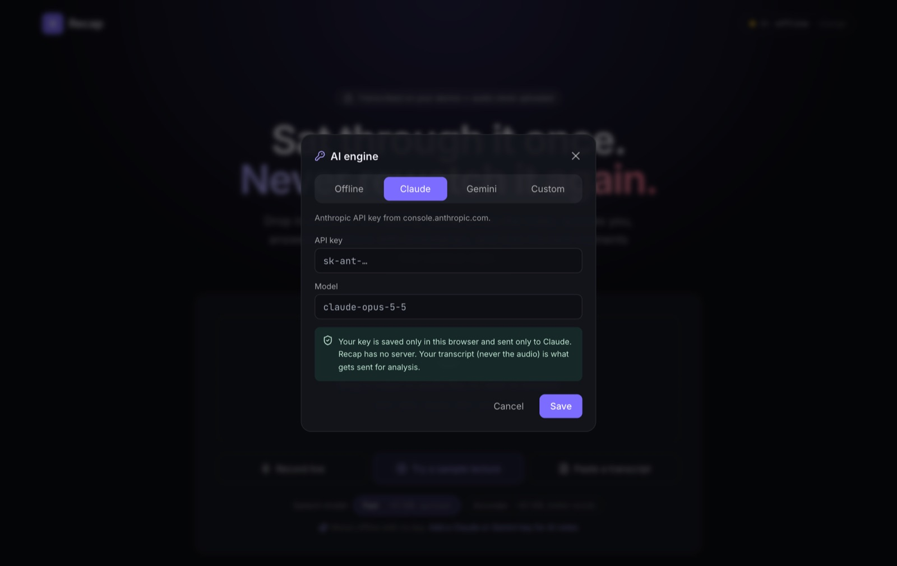
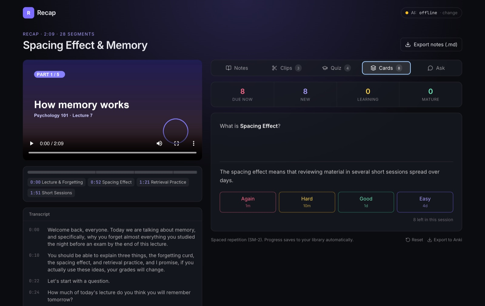
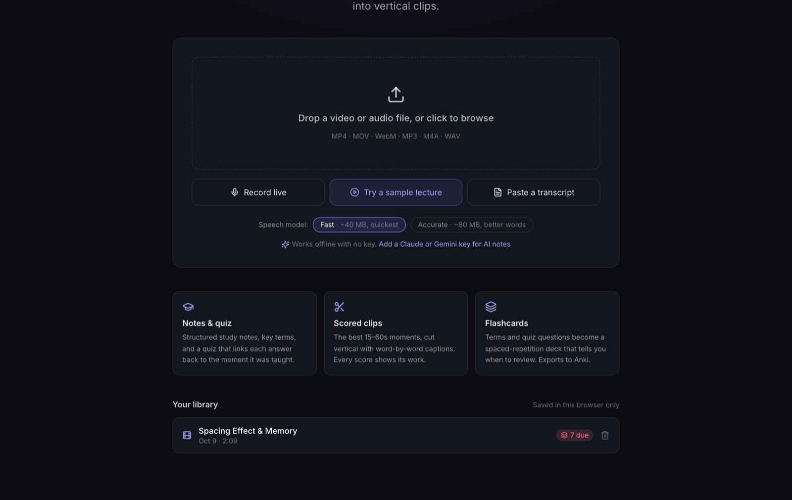

**[Try the finished app →](https://karanamtej1-lab.github.io/recap/)** Click
*Try a sample lecture* and it runs end to end in about a minute. Source is on
[GitHub](https://github.com/karanamtej1-lab/recap).

## Overview

You sit through an hour-long lecture once. Then, before the test, you either
rewatch it or wish you had taken better notes. Recap takes the recording and
gives you:

- **Notes**: a TL;DR, key points with timestamps, notes split into chapters, key
  terms, and any deadlines that were mentioned.
- **A quiz** where every answer has a button that jumps to the moment it was taught.
- **Flashcards** that tell you when to review them, and export to Anki.
- **Ask**: type a question, get an answer with clickable timestamps.
- **Clips**: the best 15 to 60 second moments, cut into vertical video with
  word-by-word captions.
- **A library**: every recap stays saved in your browser, video included.

The project started from a set of open-source apps I was looking at: a
screen copilot (cue), a voice dictation app (WhimprFlow), and a video clipper
(publikclip). Recap combines one idea from each: transcribing on your own
machine, clips whose scores show their work, and asking questions about what
you just heard.

## The goals I set

1. **Private by default.** The audio never leaves the computer. Speech-to-text
   runs inside the browser.
2. **No server at all.** Everything runs in the tab, so it's hosted for free on
   GitHub Pages and has nothing that can go down or cost money.
3. **Works with no API key.** AI makes it better, but a missing key or an
   outage should never mean a blank screen.
4. **Scores you can check.** A clip score is useless if you can't see why it
   got that number.

## How it works

### Transcribing in the browser

The file is decoded to 16 kHz mono audio with the Web Audio API. It then goes
to a Web Worker that runs OpenAI's Whisper model through **transformers.js**,
on the GPU (WebGPU) if there is one and on the CPU (WebAssembly) if not. The
audio is fed in 30-second windows, so the progress bar is real and words show
up on screen as they're recognized.

### Notes without AI: two classic algorithms

With no key, Recap still writes real notes, using two well-known NLP algorithms
I implemented from their papers:

- **TextRank** treats every sentence as a node and links sentences that share
  important words (TF-IDF cosine similarity). Then it runs PageRank, the same
  idea Google used to rank web pages. The sentences everything else "points
  to" become the key points and the TL;DR.
- **TextTiling** finds chapter breaks by comparing the vocabulary of the next
  few sentences with the previous few. Where the overlap drops, the topic
  changed. That only gets close, so I added one more step: speakers announce
  topic changes out loud ("So here's…", "Now, …", "Let's…"), so each break
  snaps to a nearby sentence that opens with one of those cues. On the sample
  lecture, that moved the breaks from about 8 seconds off to within half a
  second of the real section starts.

### Notes with AI, straight from the browser

Recap has no server, so the AI request goes straight from your browser to
**Claude** or **Gemini** using your own key. The key is saved only in your
browser and sent only to that provider. Before building this, I checked which
providers allow browser requests (CORS). Claude and Gemini do. The publik API
doesn't, so I couldn't use it here.

**Long lectures are split into parts.** A transcript over about 30 minutes is
cut into parts, and 3 parts are analyzed at the same time. My code then merges
the results: it picks the best clips by score, removes duplicate terms, and
spreads the quiz questions across the whole lecture. Only the title and TL;DR
need one more small AI call.

I don't trust the model's numbers. Every timestamp it returns is snapped onto
a real sentence in the transcript. Clips with impossible ranges are thrown
out. Quiz questions whose answer index points nowhere are dropped.

### Scoring and cutting clips

Each candidate clip gets four scores from 0 to 10: **hook** (would the first
line stop a scroll), **insight**, **standalone** (does it make sense without
the rest of the talk), and **energy**. The overall score is a weighted sum
that my code calculates, never a number the model makes up.

The vertical video is drawn on a 720×1280 canvas: the picture, a hook card on
top, and the caption with the current word highlighted. "Fit" mode keeps whole
slides readable over a blurred copy of themselves. `MediaRecorder` records the
canvas plus the audio and saves an MP4. Nothing gets uploaded.

### Flashcards and spaced review

The sample lecture is about why spaced review beats cramming, so it felt wrong
not to build it in. Key terms and quiz questions become flashcards. After each
card you rate how well you knew it, and a small version of **SM-2**, the
scheduling algorithm behind SuperMemo and early Anki, decides when you see it
next. Cards you get right come back after 1 day, then 3, then 8, then about 26.
Miss one and it comes back in a minute.

Everything is saved in **IndexedDB**, the browser's built-in database: the
transcript, the recap, your review progress, and the original video file. So
the library opens instantly without re-transcribing, and the home screen shows
how many cards are due.

## What broke, and what I learned

**Timestamps drifting up to 16 seconds.** On my first sample video, every
section's timestamps came out earlier than the last, a few seconds more each
time. I blamed Whisper's word timing and switched to phrase timing. The drift
didn't change, which proved me wrong. The real cause was the sample file: I
had joined the audio pieces in a way that left gaps between them. The video
player plays those gaps as silence, but the browser's audio decoder skips
them, so the decoded audio was 16 seconds shorter than the video. Lesson: when
a fix doesn't change the symptom, the diagnosis is wrong.

**Deploying was blocked, so I removed the server.** The first version had a
small server for the AI calls, and I couldn't get permission to create the
hosting project for it. Instead of waiting, I moved the AI calls into the
browser with bring-your-own-key. Now Recap runs on free static hosting, and
nobody else's key or money is involved.

**Chapter titles that came out wrong.** The intro of the sample lecture names
all three topics, so it kept stealing the best chapter title. That left the
real "spacing effect" chapter titled after the word "feels." The fix was to
assign titles across all chapters at once: each phrase goes to the chapter
that says it most often.

**The library that wouldn't bundle, and styles that vanished.**
transformers.js ships parts of its runtime that Next.js couldn't build, so the
worker loads it from a CDN at runtime instead. And Tailwind looks for source
files relative to the folder the server is started from, so starting it from
another folder quietly produced an empty stylesheet. Absolute paths fixed it.

**Speech recognition isn't perfect.** In the screenshots, the small Whisper
model heard "forgetting curve" as "forgetting curd" and "1880s" as "the 18th In
1980s." The "Accurate" model makes fewer mistakes like that, but it's twice the
download.

## Status

Live at
**[karanamtej1-lab.github.io/recap](https://karanamtej1-lab.github.io/recap/)**.
The screenshots show the offline engine. AI mode turns on when you paste a
Claude or Gemini key. I tested it, including the split-into-parts path on a
68-minute transcript, against a fake AI server that I ran locally. Next step:
run it on a real hour-long lecture with a real key.
