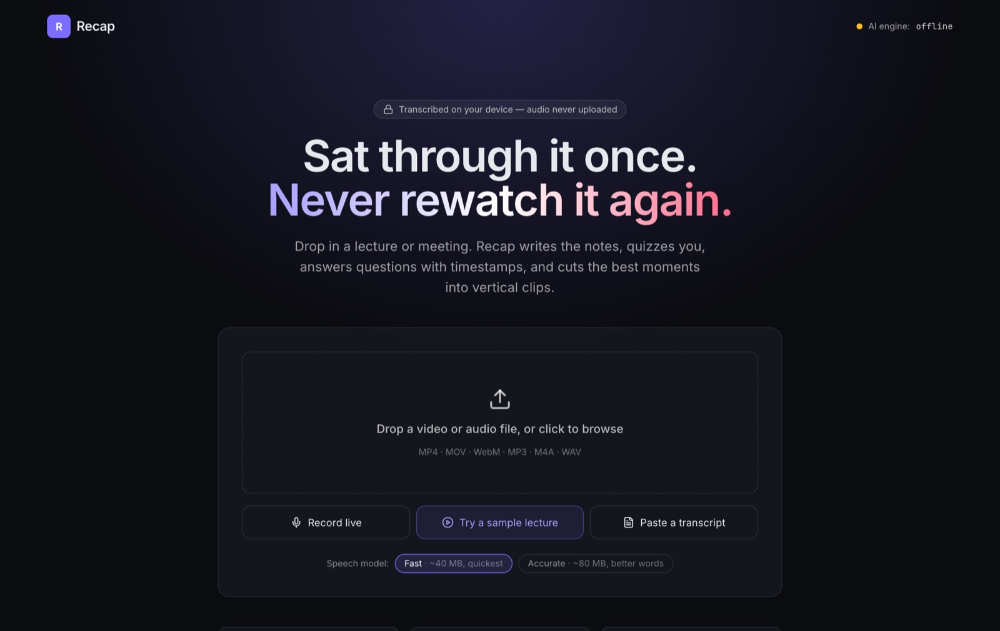
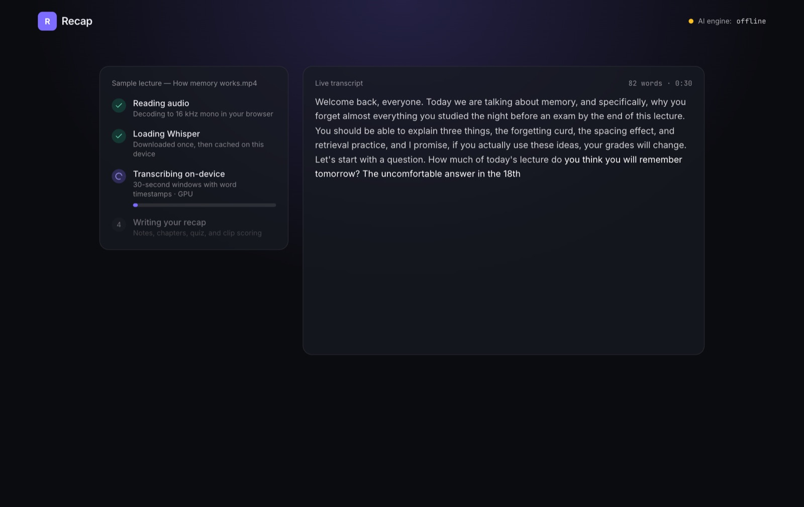
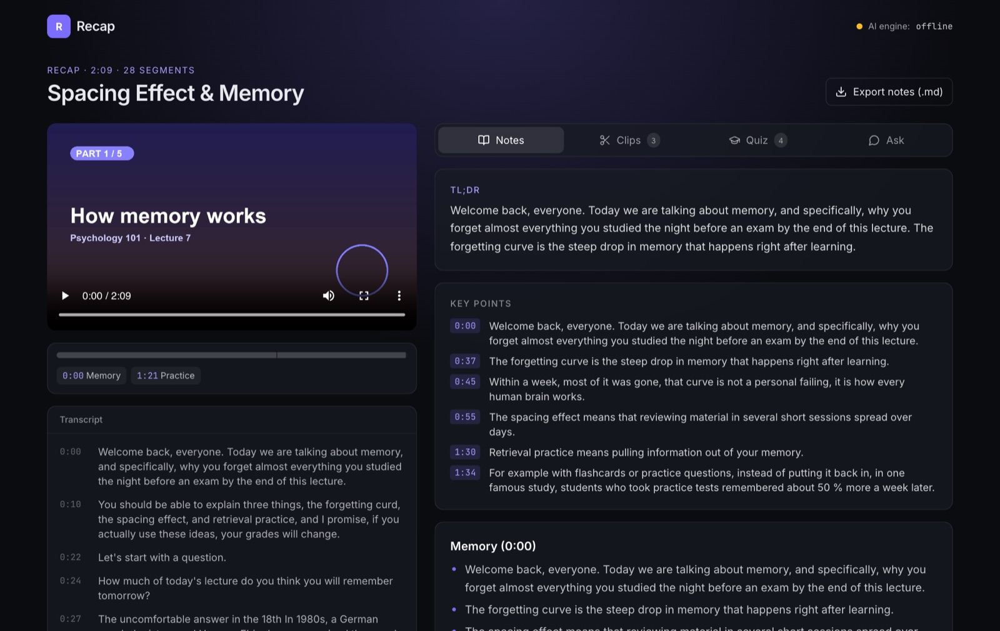
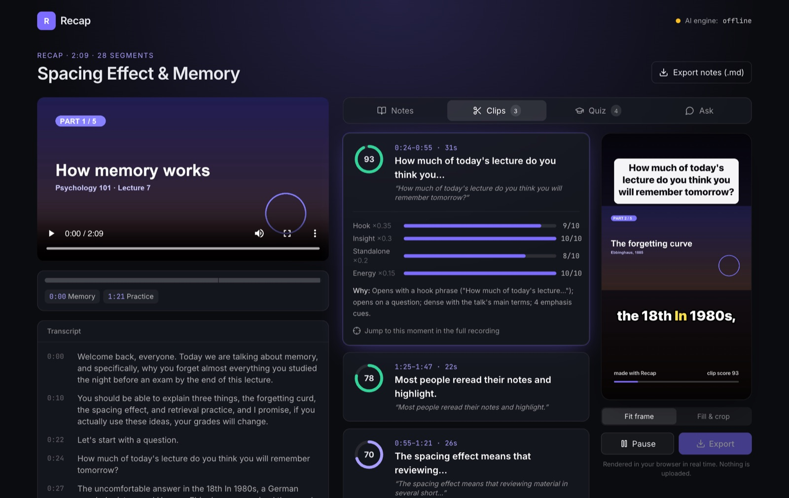
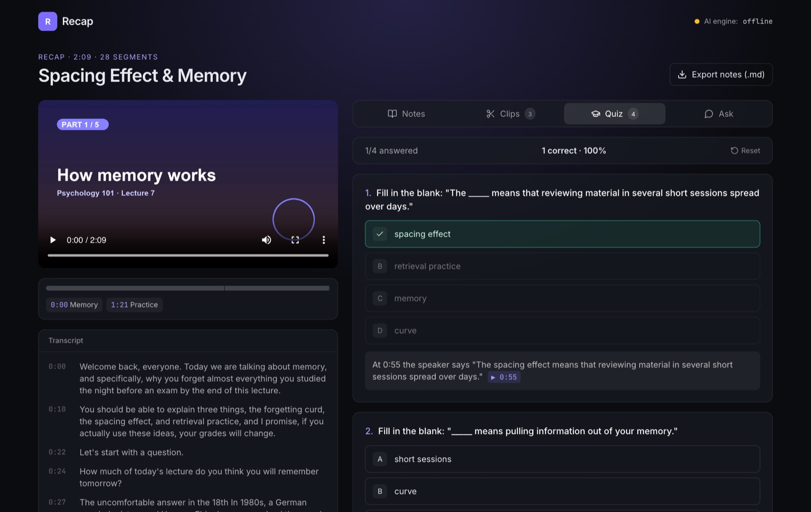

**[See the code on GitHub →](https://github.com/karanamtej1-lab/recap)** It
runs locally with `npm install && npm run dev`, and a built-in sample lecture
lets you try it in two minutes.

## Overview

You sit through an hour-long lecture once. Then, before the test, you either
rewatch it or wish you had taken better notes. Recap takes the recording and
gives you:

- **Notes**: a TL;DR, key points with timestamps, notes organized by topic, key
  terms, and any deadlines that were mentioned.
- **A quiz** where every answer has a button that jumps to the moment it was taught.
- **Ask**: type a question, get an answer with clickable timestamps.
- **Clips**: the best 15 to 60 second moments, cut into vertical video with
  word-by-word captions, ready to post.

The project started from a set of open-source apps I was looking at: a
screen copilot (cue), a voice dictation app (WhimprFlow), and a video clipper
(publikclip). Recap combines one idea from each: transcribing on your own
machine, clips whose scores show their work, and asking questions about what
you just heard.

## The goals I set

1. **Private by default.** The audio never leaves the computer. Speech-to-text
   runs inside the browser.
2. **Works with no API key.** AI makes it better, but a missing key, an empty
   balance, or an outage should never mean a blank screen.
3. **Scores you can check.** A clip score is useless if you can't see why it
   got that number.

## How it works

### Transcribing in the browser

The file is decoded to 16 kHz mono audio with the Web Audio API. It then goes
to a Web Worker that runs OpenAI's Whisper model through **transformers.js**,
on the GPU (WebGPU) if there is one and on the CPU (WebAssembly) if not. The
audio is fed in 30-second windows, so the progress bar is real and words show
up on screen as they're recognized.

Each word comes back with its own timestamp. I group words into sentences
(splitting on punctuation and on pauses over a second). Those sentences are
what the notes, search, and AI work from.

### Writing the recap

The timestamped transcript goes to a server route that tries **Claude**, then
**Gemini**, then the **publik API**, depending on which key is set. If none is
set, or the call fails, an offline analyzer I wrote takes over. It's plain text
statistics: keyword density, cue phrases like "the key is" or "is due on", and
two-word phrases that repeat. Repeated pairs like "spacing effect" and
"retrieval practice" turned out to find the key terms far better than single
words, which kept surfacing junk like "three" and "remember".

I don't trust the model's numbers. Every timestamp it returns is snapped onto
a real sentence in the transcript. Clips with impossible ranges are thrown
out, and quiz questions whose answer index points nowhere are dropped. I
tested this by pointing the app at a fake AI server that returned deliberately
broken answers.

### Scoring and cutting clips

Each candidate clip gets four scores from 0 to 10: **hook** (would the first
line stop a scroll), **insight**, **standalone** (does it make sense without
the rest of the talk), and **energy**. The overall score is a weighted sum
that my code calculates, never a number the model makes up, so every point
traces back to a bar on screen.

The vertical video is drawn on a 720×1280 canvas. A hidden video element
plays the clip, and every frame I draw the picture, a hook card on top, and the
caption with the current word highlighted. "Fit" mode keeps the whole frame
over a blurred copy of itself so slides stay readable. "Fill" crops to the
center for a talking head. `MediaRecorder` records the canvas plus the audio
and saves an MP4. Nothing gets uploaded.

## What broke, and what I learned

**Timestamps drifting up to 16 seconds.** On my first sample video, every
section's timestamps came out earlier than the last, a few seconds more each
time. I blamed Whisper's word timing and switched to phrase timing. The drift
didn't change, which proved me wrong. The real cause was the sample file: I
had joined the audio pieces in a way that left gaps between them. The video
player plays those gaps as silence, but the browser's audio decoder skips
them, so the decoded audio was 16 seconds shorter than the video. After I
rebuilt the sample with continuous audio, I measured both timing modes against
the real section boundaries. Word timing was within 0.4 seconds, so I went
back to it. Lesson: when a fix doesn't change the symptom, the diagnosis is
wrong.

**The library that wouldn't bundle.** transformers.js ships parts of its
runtime that Next.js couldn't build. The fix was to load it from a CDN inside
the worker at runtime instead of bundling it, which also made the page lighter.

**The styles that vanished.** At one point the app loaded with no styling at
all. Tailwind finds its source files relative to the folder the server is
started from, not the folder its config file is in. Starting the server from a
different folder quietly produced an empty stylesheet. Using absolute paths
fixed it for good.

**Speech recognition isn't perfect.** In the screenshots above, the small
Whisper model heard "forgetting curve" as "forgetting curd" and "1880s" as
"the 18th In 1980s". The bigger "Accurate" model makes fewer mistakes like
that, but it's twice the download.

## Status

Working locally, source on
**[GitHub](https://github.com/karanamtej1-lab/recap)**. The screenshots show the
offline engine. The Claude, Gemini, and publik providers are built in and turn
on when you add a key. Next step: deploy it, and send long lectures to the AI
in chunks so the cost doesn't grow with every extra minute of recording.
